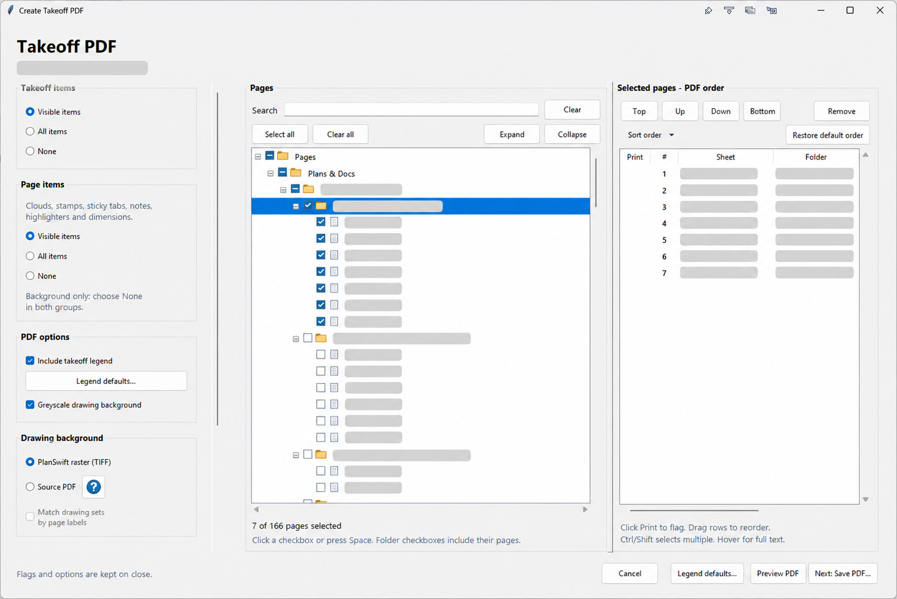
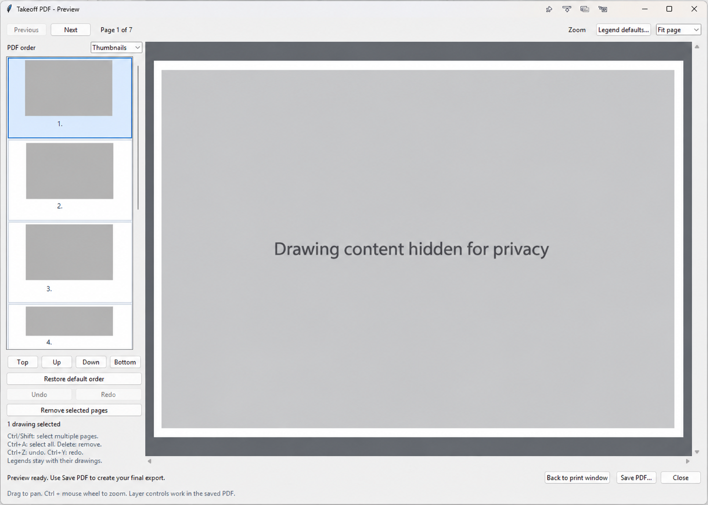
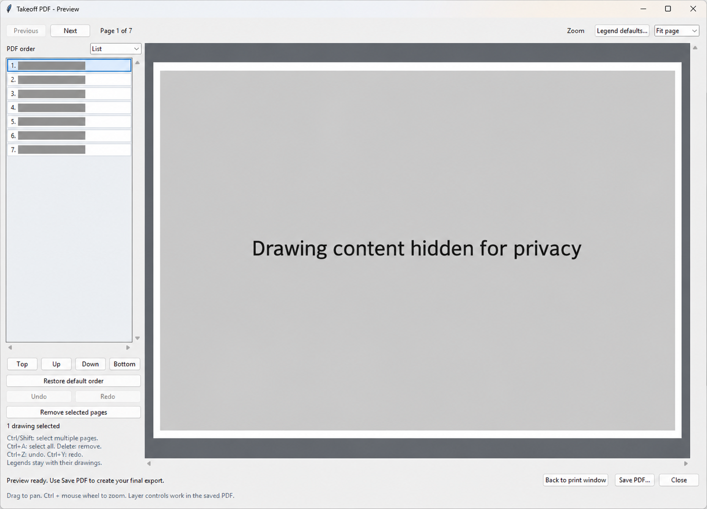

<div align="center">

# Takeoff PDF Community

### Turn your PlanSwift takeoff into an interactive PDF.

Searchable legends · Click-to-highlight takeoff · Layer controls · Visual export preview


[](LICENSE.txt)

**[Download plugin](https://github.com/Arthur-mx/planswift-takeoff-pdf-community/raw/refs/heads/main/downloads/Takeoff%20PDF%20Community%201.1.0.SwiftPluginPackage)** · **[Download helpers](https://github.com/Arthur-mx/planswift-takeoff-pdf-community/raw/refs/heads/main/downloads/Takeoff-PDF-Community-1.1.0.zip)** · **[Get started](#get-started)** · **[Try the demo](examples/Interactive%20Demo.pdf)**

</div>

Export selected PlanSwift sheets with their takeoff, page annotations, quantities, and a legend that does more than explain colors. Readers can **hide or show takeoff layers** and **click a legend description to highlight its tracing** in the saved PDF.

## A legend you can use

[](examples/Interactive%20Demo.pdf)

*Fictional demonstration drawing. No customer plans or project quantities are shown in this example.*

| In the legend | What it does |
| --- | --- |
| **Searchable text** | Find and select descriptions, page quantities, and units. |
| **Eye controls** | Hide or show an individual takeoff item. |
| **Click a description** | Highlight that item's tracing with point markers. |
| **Hide all / Show all** | Change the visibility of the takeoff layers together. |
| **Clear highlight** | Return to the ordinary takeoff appearance. |

Legend interactions have been user-tested in **Bluebeam Revu** and **PDF-XChange**. Download the [synthetic interactive demo](examples/Interactive%20Demo.pdf) and open it in a layer-capable desktop PDF reader to try them. GitHub, browser viewers, and the built-in export preview may show the appearance without supporting the interactive controls.

## Choose, arrange, and preview

*The following interface images have been edited for privacy. Project names, sheet identifiers, quantities, and drawing content are covered; minor visual details may differ from the application.*

[](docs/screenshots/export-window.png)

- **Find pages quickly:** searchable folder tree, page and folder checkboxes, and saved Print flags.
- **Build the right set:** drag pages into order, move selections up or down, or restore the original order.
- **Choose what appears:** separate Visible / All / None options for takeoff items and page items.
- **Choose the background:** PlanSwift raster images or matching source PDFs, including labeled drawing sets and source availability checks.
- **Set your legend defaults visually:** choose a preferred area and text size for portrait and landscape sheets. Existing PlanSwift Legend boxes keep priority.
- **Include page annotations:** revision cloud outlines, rubber stamps, sticky tabs, notes, highlighters, and dimensions.

### Preview before saving

| Thumbnail view | List view |
| --- | --- |
| [](docs/screenshots/preview-thumbnails.png) | [](docs/screenshots/preview-list.png) |
| Identify sheets visually while arranging the set. | Use a compact list when you have many sheets. |

The preview remembers your preferred view. Select multiple pages, drag them together, remove sheets, and use **Undo / Redo**. Return to the print window to adjust the export options. Click any screenshot above to see it at full size.

## Get started

**You need:** Windows, a licensed PlanSwift installation with plugin tools, and **64-bit Python 3.10–3.13** with pip and Tcl/Tk. Installation needs an internet connection to download the PDF dependency.

1. **[Download the helper ZIP](https://github.com/Arthur-mx/planswift-takeoff-pdf-community/raw/refs/heads/main/downloads/Takeoff-PDF-Community-1.1.0.zip)** and **[the matching PlanSwift plugin package](https://github.com/Arthur-mx/planswift-takeoff-pdf-community/raw/refs/heads/main/downloads/Takeoff%20PDF%20Community%201.1.0.SwiftPluginPackage)**. Extract the helper ZIP completely.
2. **Run `Install.cmd`** from the extracted folder. Wait for “Installation complete.”
3. **Double-click `Takeoff PDF Community 1.1.0.SwiftPluginPackage`** in Windows. With PlanSwift installed, this opens its package installer. Follow the installation prompts. If Windows does not recognize the file, use PlanSwift's **Import Plugin Package** command instead.
4. **Open a small test job**, choose your sheets, and select **Preview PDF**. Save the PDF and test its legend controls in your desktop reader.

**Both downloads are required:** the SwiftPluginPackage installs the PlanSwift command; `Install.cmd` installs the Python helpers it uses. No Shell Execute path is needed. The packaged command is currently named **Export takeoff to pdf**, under **Claude Scripts → Misc** in the plugin tree.

For customization, the complete [PlanSwift Script TXT](Takeoff%20PDF%20Community%20-%20PlanSwift%20Script.txt) and [repository source ZIP](https://github.com/Arthur-mx/planswift-takeoff-pdf-community/archive/refs/heads/main.zip) remain available. Copy from the plain TXT, not a comparison view showing removed lines. When upgrading, update both the helpers and the matching plugin package.

The installer uses a dedicated folder and Python environment:

```text
%LOCALAPPDATA%\PlanSwift\Takeoff PDF Community
```

This community edition keeps its installed files and preferences separate from the personal exporter. It uses ordinary takeoff items and their PlanSwift colors, without requiring custom linked-item fields or private workflow rules.

### Using source PDFs

Use individual sheet PDFs named to match the PlanSwift sheet IDs, or a drawing-set PDF with matching **page labels**. Choose the source folder in the export window; it can differ from the destination folder. Matching sheets must have the same revision, crop, and orientation as the PlanSwift drawings. This mode still needs PlanSwift's TIFF data for alignment. See the [user guide](USER_GUIDE.txt) for setup details.

## Guides and contributing

| Looking for… | Start here |
| --- | --- |
| Installation, updates, and troubleshooting | [Installation guide](INSTALL.txt) |
| Print flags, source PDFs, legend controls, and preview | [User guide](USER_GUIDE.txt) |
| What's included in this version | [Release notes](RELEASE_NOTES.txt) |
| Adding screenshots to this page | [Screenshot guide](docs/screenshots/README.md) |
| Developing or customizing the plugin | [Contributing](CONTRIBUTING.txt) · [Developer starter context](DEVELOPER_STARTER_PROMPT.txt) |
| Building and sharing a plugin package | [Plugin export fields](PLUGIN_EXPORT_FIELDS.txt) · [Publishing checklist](PUBLISHING.txt) |

Ideas, bug reports, and contributions are welcome. Include your PlanSwift and PDF-reader versions when reporting a problem, and use a small synthetic example where possible. See [CONTRIBUTING.txt](CONTRIBUTING.txt) for the test workflow.

## License and project status

**GNU AGPL v3 only.** See [LICENSE.txt](LICENSE.txt), [third-party notices](THIRD_PARTY_NOTICES.txt), and the [source review](SOURCE_REVIEW.txt). The PlanSwift script is part of the source and must accompany redistributed packages as described in those documents.

This is an independent, unofficial community project. PlanSwift is not included. Host behavior can vary by PlanSwift version; check a small export before relying on a full drawing set.
